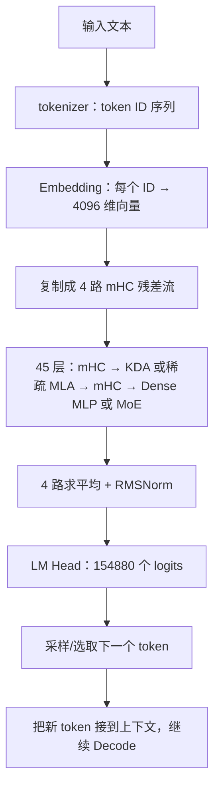

---
tags:
  - GLM
  - 推理
  - 线性注意力
  - 稀疏注意力
  - MoE
---

# GLM-5.3-Flash 推理时到底算了什么？

!!! abstract "先记住这一句话"

    输入被切成 token，查表变成向量；向量沿着 **4 条残差流**穿过 45 层。多数层用 **KDA 小型状态矩阵**记住历史，每隔几层用 **稀疏 MLA**回看选中的原文位置；后 42 层的前馈部分还会为每个 token 选 **8 个路由专家，加 1 个共享专家**。最后把 4 条流求平均，算出词表中每个 token 的分数，选出下一个 token，再重复。

本文讲的是**模型前向计算**，即一次输入怎样变成下一个 token。回答问题时可见的“思考文字”本身也是模型逐 token 生成的；它不是另一个神秘的数值计算模块。文中的小数例子是为了手算而设的玩具权重，**不是 GLM-5.3-Flash 实际权重或实际回答**。

## 1. 依据与阅读地图

截至 **2026-09-28**，本文以官方 `zai-org/GLM-5.3-Flash` checkpoint 的 [`config.json`](https://huggingface.co/zai-org/GLM-5.3-Flash/blob/eb9eb208eb0d988989d07a6a12d0fdeb5f52574a/config.json) 和 Hugging Face Transformers 的 [`modeling_glm5_next.py`](https://github.com/huggingface/transformers/blob/07338b6c74a578868368e6e549dea83414e4b8cb/src/transformers/models/glm5_next/modeling_glm5_next.py) 为基线。后者是便于读懂公式的参考实现；高性能推理引擎可能融合算子、分块、量化或分布到多卡，但应保持同一模型的计算语义。官方设计说明见 [GLM-5.3-Flash 技术博客](https://z.ai/blog/glm-5.3-flash)。

按这个顺序看源码即可：

| 想找什么 | 类或方法 | 作用 |
|---|---|---|
| 输入和 45 层循环 | `Glm5NextTextModel.forward` | embedding、复制 4 路、逐层前向、末尾合并 |
| 一层的执行顺序 | `Glm5NextTextDecoderLayer.forward` | mHC → 注意力 → mHC → MLP/MoE |
| 多数层怎样记历史 | `Glm5NextTextLinearAttention.forward`、`recurrent_kimi_delta_attention` | 短卷积、遗忘/写入、状态读取 |
| 少数层怎样找原文 | `Glm5NextTextIndexer.forward`、`Glm5NextTextAttention.forward` | IndexPool、Top-K、稀疏 MLA |
| 专家怎么选 | `Glm5NextTextTopkRouter.forward`、`Glm5NextTextMoE.forward` | Top-8 路由和共享专家 |
| 最终分数 | `Glm5NextForConditionalGeneration.forward` | LM Head 输出 logits |

## 2. 先看真实模型的尺寸

公开配置给出的主要参数如下。`T` 表示当前输入中的 token 数，`B` 表示同时处理的请求数。

| 部分 | 配置 | 直白理解 |
|---|---:|---|
| 文本隐藏宽度 | 4096 | 每个 token 在主干中用 4096 个数表示 |
| 主干层数 | 45 | 依次通过 45 个计算层 |
| mHC 残差流 | 4 | 层与层之间并行保留 4 份 4096 维表示 |
| KDA / 稀疏 MLA 层 | 34 / 11 | 0、1、2 层用 KDA，第 3 层用稀疏 MLA，此后基本每 4 层重复 |
| KDA | 64 头，每头 128 维 | 每个头维护一个历史状态矩阵；短卷积核宽度为 4 |
| 稀疏 MLA | 64 头，KV latent 512 维 | 缓存压缩后的历史表示，注意力主路径从中恢复 K/V |
| IndexPool / Top-K | 4 / 2048 | 每 4 个索引 key 组成候选池，最多挑 512 池，再展开成最多 2048 个原位置；不足 4 个的当前尾部还可额外加入 |
| MLP / MoE | 前 3 层 Dense；后 42 层 MoE | MoE 从 288 个路由专家中选 8 个，并运行 1 个共享专家 |
| 词表 / 最大位置 | 154880 / 1048576 | 输出分数的候选 token 数 / 配置声明的上下文上限 |

注意：**GLM-5.3-Flash 与 GLM-5.2 不是同一套层结构**。GLM-5.2 的 78 层 MLA/DSA 结构不能直接套到这里。模型的“约 320B 总参数、18B 激活参数”是官方的规模概述，不等于每步只需把 18B 参数从零加载一遍，也不代表所有硬件上的实际延迟。

## 3. 一个完整例子：输入问题、生成「5」、然后停止

现在只跟踪**一次请求**。假设用户问「`2+3等于几？`」，模型使用贪心选择；为展示停止条件，假设它先生成文本 token「`5`」，再生成结束 token `<eos>`，于是用户最终看到「`5`」。这是**假设的输出轨迹**，不是一次真实模型运行的记录。真实 tokenizer、权重和提示模板会决定实际 token 与分数。

为了让缓存长度能写清，假设聊天模板和 tokenizer 最终得到 4 个输入 token：`[p₀,p₁,p₂,p₃]`。真实模板通常包含角色等特殊 token，这里把它们折进这 4 个占位符。下面的**流程和张量形状按真实配置**写；手算用的标量和最后几个候选分数则是教学数据。

### 3.1 第一次前向：Prefill 一次处理 4 个输入 token

开始时，所有层的历史缓存都是空的。Embedding 依次查出 4 个 4096 维向量，形状 `[1,4,4096]`；复制为 4 路 mHC 流后是 `[1,4,4,4096]`。45 层都要算，但每个位置只能看到自身及更早的输入。第 4 个输入位置 `p₃` 的末层输出用于预测**第一个生成 token**。

| 经过的层 | 注意力 | 前馈 | 本次需要保存的历史 |
|---|---|---|---|
| 0、1、2 | KDA | Dense MLP | 各层的 KDA 循环状态、短卷积尾部 |
| 3 | 稀疏 MLA | MoE | 本层 4 个位置的 latent KV 和索引器状态 |
| 4～42 | 30 层 KDA、9 层稀疏 MLA，按每 4 层 3+1 交替 | 每层 MoE | 分别更新本层对应的状态或缓存 |
| 43 | 稀疏 MLA | MoE | 本层的 latent KV 和索引器状态 |
| 44 | KDA | MoE | 本层的 KDA 状态、短卷积尾部 |

这张表列完了 **45 层**：34 层 KDA、11 层稀疏 MLA；前 3 层 Dense、后 42 层 MoE。层与层之间传递的是 4 路隐藏向量，**每一层各有自己的缓存**，不会把第 0 层的状态直接当作第 44 层的状态。

### 3.2 把其中一层真的算一遍：第 4 层的 `p₃`

第 4 层是 **KDA + MoE**。假设前 4 层已把 `p₃` 的 4 路隐藏状态算成 $(1,2,3,4)$；这里把每路的 4096 维只截成**一个玩具标量**。同一个请求的其他位置也在计算，只是暂时不写它们的数字。

**第一步：注意力前的 mHC。** 设本次 `pre=(0.1,0.2,0.3,0.4)`，则输入 KDA 的标量是
$u=0.1\times1+0.2\times2+0.3\times3+0.4\times4=3$。真实代码还会对它做 RMSNorm，再生成 Q/K/V 和门。为了追踪 KDA 更新，假设其中**一个头的一个状态元素**在前 3 个输入 token 之后为 $S_{p_2}=2$；当前投影、卷积和门给出 $q=k=1$、$v=3$、遗忘系数 $0.5$、写入系数 $\beta=0.5$：

$$
\underbrace{2\times0.5}_{\text{遗忘后状态 }1}
\xrightarrow{\text{读旧值 }1}
\underbrace{0.5(3-1)}_{\text{修正量 }1}
\xrightarrow{\text{写入}}
S_{p_3}=1+1=2
\xrightarrow{q=1}
o_{p_3}=2.
$$

因此这个小状态从 `2` 更新成 `2`，而本次读出的 KDA 值也是 `2`。本例再假设门控归一化和输出投影使注意力子层输出为标量 `2`。令 mHC 的 `post=(0.5,1,0.5,1)`；为演示旧流混合，取一个行列和均为 1 的矩阵：对角线为 `0.7`、其余元素为 `0.1`。旧流混合后为 $(1.6,2.2,2.8,3.4)$，再分配注意力输出，得到

$$x_{\text{attn}}=(1.6,2.2,2.8,3.4)+(1,2,1,2)=(2.6,4.2,3.8,5.4).$$

**第二步：前馈前的 mHC 和 MoE。** 设这套 mHC 的 `pre=(0.25,0.25,0.25,0.25)`，便得到 MoE 输入 $(2.6+4.2+3.8+5.4)/4=4$。实际会从 288 个专家中选 8 个；在这个缩小的例子里，假设只看两个已选专家，它们的原始分数为 `0.8、0.2`，输出为 `3、7`，共享专家输出 `1`。按真实配置的 `2.5` 路由缩放，玩具 MoE 输出为

$$F_{\text{MoE}}(4)=2.5(0.8\times3+0.2\times7)+1=10.5.$$

若第二套 mHC 使用同样的旧流混合矩阵、`post=(1,1,1,1)`，则 $(2.6,4.2,3.8,5.4)$ 先混合成 $(3.16,4.12,3.88,4.84)$，再加上 MoE 输出，**第 4 层结束的 4 路状态**是 $(13.66,14.62,14.38,15.34)$。这就是一层里 `mHC → KDA → mHC → MoE` 的完整计算次序。真实层使用 4096 维向量、64 个 KDA 头、8 个被选专家；这里的权重和数字是人为指定的，因此不能接着推算真实模型的答案。

### 3.3 继续走完剩下的层，选出第一个输出 token

第 5、6 层继续用 KDA，第 7 层改用稀疏 MLA；如此前进到第 43 层的稀疏 MLA 和第 44 层的 KDA。稀疏 MLA 层会保存 `p₀…p₃` 各位置的 latent KV，索引器先挑相关位置，主注意力只对入选位置算 softmax；每层前馈照样完成 MoE 路由。第 44 层结束后，**只取最后一个输入位置 `p₃`** 的 4 路状态，求平均、做 RMSNorm，并由 LM Head 得到 154880 个 logits。

为了完成这个玩具轨迹，假设只看候选「`5`」「`6`」和 `<eos>`，其 logits 为 `(2,1,0)`。softmax 约为 `(0.665,0.245,0.090)`，贪心选择「`5`」。这一步的状态是：**生成结果已有 `5`，但所有层的缓存目前只包含 `p₀…p₃`；新生成的 `5` 尚未经过模型，也不在缓存里。**

### 3.4 第二次前向：Decode 只输入刚生成的「5」

现在把 token「`5`」作为新的输入，形状从 Prefill 的 `[1,4]` 变成 Decode 的 `[1,1]`，位置是 `p₄`。它再次走**全部 45 层**，并非只跑最后一层：

1. 每个 KDA 层读取自己在 Prefill 留下的循环状态和短卷积尾部；为 `p₄` 算新 Q/K/V，更新本层状态，再给后面的层传出结果。
2. 每个稀疏 MLA 层为 `p₄` 追加本层 latent KV 与索引信息；IndexPool 在已有历史中选池，主注意力读取选中位置的 V。
3. 每个 MoE 层**重新**按 `p₄` 的隐藏向量选专家。它与 `p₃` 可能选中不同的 8 个专家。
4. 第 44 层后再求平均、归一化、投影，得到下一 token 的 logits。

假设这次玩具 logits 对「`5`」「`6`」和 `<eos>` 是 `(0,0,2)`，则 `<eos>` 的 softmax 概率约为 `0.787`，贪心选择 `<eos>`。推理服务看到结束 token 就停止，最终返回文本「`5`」。此时缓存已经处理过 `p₀…p₄`；**结束 token 通常不必再送入第三次前向**。真实服务也可能因达到最大输出长度或其他停止条件而结束。

| 调用 | 喂给模型的 token | 调用前缓存 | 这次选出的 token | 调用后缓存 |
|---|---|---|---|---|
| Prefill | `p₀,p₁,p₂,p₃` | 空 | `5` | 已处理 `p₀…p₃` |
| Decode | `5`，即 `p₄` | 已处理 `p₀…p₃` | `<eos>` | 已处理 `p₀…p₄` |
| 停止 | 无需再调用模型 | 已处理 `p₀…p₄` | 返回文本 `5` | 可释放请求缓存 |

**完整的一次推理就到这里。** 下面各节再把表中压缩写法展开，说明 Embedding、mHC、KDA、稀疏 MLA 和 MoE 的一般计算规则。

## 4. 从一句问题走到第一次预测

沿用第 3 节的请求和占位 token `[p₀,p₁,p₂,p₃]`。**真实切词结果取决于 tokenizer**，这里不声称每个汉字或符号恰好是一个 token。

### 4.1 Token ID 变成向量

Embedding 是一张参数表，形状为 `[154880, 4096]`。若一个 token 的 ID 是 `i`，就取这张表的第 `i` 行。4 个输入 token 得到 `[1,4,4096]`，其中首维是 `B=1`。这一步主要是**查表**，不是按字符做加法。

`Glm5NextTextModel.forward` 随后把每个向量复制成 4 路，形状变为 `[1,4,4,4096]`。第二个 `4` 是 token 数，第三个 `4` 是 mHC 流数；这两个数字碰巧相同，含义不同。Prefill 阶段把已知的多个 token 一次送入模型，并严格限制每个位置只能使用自己及之前的位置；这里尚未逐个生成输出。

### 4.2 mHC：四条“笔记”如何传给一个子层

每层的注意力和前馈网络各有一次 mHC。对同一个 token，设进入子层的 4 路向量为 $x_1,\ldots,x_4$。mHC 从这 4 路内容算出三类权重：

1. `pre`：把 4 路合成**一条** 4096 维输入，$u=\sum_i p_i x_i$。
2. `comb`：用一个经过 Sinkhorn 归一化的 $4\times4$ 矩阵混合旧流。其行、列的和都接近 1，以约束反复跨层混合的数值尺度。
3. `post`：把**只计算一次**的注意力或 MLP 输出 $F(u)$ 分配回 4 路。

可以把它写成 $x'_j=\sum_i C_{ij}x_i+r_j F(u)$。实际还包含权重生成、归一化等细节，但核心是：**保留 4 路历史，只让重计算的子层跑一遍**。

第 3.2 节已经用同一请求中的第 4 层展示了 `pre → KDA → comb/post → pre → MoE → comb/post` 的完整数值流。真实模型是 4 路 4096 维，系数随 token 内容变化。

## 5. 多数层：KDA 怎样用固定状态“记历史”

第 0、1、2、4、5、6……层走 KDA。它的直觉是：不为当前 token 和所有历史 token 都形成一个完整的注意力分数列表，而是把历史压进**每个头的状态矩阵**。这让 Decode 时的历史状态大小不随已生成 token 数线性增长，但压缩可能丢失某些细节，所以模型还穿插稀疏 MLA。

### 5.1 子层先准备 Q、K、V 和门

mHC 合并后的输入先经 RMSNorm，得到 `[B,T,4096]`。KDA 的 Q、K、V 各投影到 `64×128=8192` 维。随后对拼起来的 Q/K/V 做**逐通道、因果的 4-token 短卷积**和 SiLU：当前 token 可混合自己与最近几个 token 的投影；单 token Decode 时要保留卷积尾部状态。

此外模型算出两种控制量：$g_t$ 是每个头、每个特征维度的遗忘量，$\beta_t$ 是每个头的写入强度。Q、K 在 KDA 核中做 L2 归一化，Q 还乘上 $1/\sqrt{128}$。把每个头的状态记成 $S_t\in\mathbb{R}^{128\times128}$，源码中的单步递推可以概括为：

$$
\begin{aligned}
\widetilde S_t &= \operatorname{diag}(e^{g_t})S_{t-1},\\
\widehat v_t &= k_t^\top\widetilde S_t,\\
\Delta_t &= \beta_t(v_t-\widehat v_t),\\
S_t &= \widetilde S_t+k_t\Delta_t^\top,\\
o_t &= q_t^\top S_t.
\end{aligned}
$$

按源码的矩阵摆放，`diag(exp(g))` 缩放的是状态的 **key 维**；这里 $q,k,v$ 都是列向量。读成中文就是：**先遗忘一部分旧记忆 → 看旧记忆对当前 key 会给出什么 value → 只写入“目标 value 与旧预测的差” → 用当前 query 读出结果**。最后再做带门的 RMSNorm 和输出投影，回到 4096 维。

第 3.2 节的 $S_{p_2}=2\rightarrow S_{p_3}=2$ 就是这组公式在**一个状态元素**上的手算。真实状态是矩阵，还有归一化与投影。

### 5.2 Prefill 和 Decode 走哪条计算路径

- **Prefill**：已知一长段输入时，参考实现用 `chunk_kimi_delta_attention` 分块计算，结果等价于按因果顺序更新状态；最后保存状态和短卷积尾部。
- **Decode**：已有历史状态且本次只有 1 个新 token 时，用 `causal_conv1d_update` 更新卷积状态，再用 `recurrent_kimi_delta_attention` 更新并读取 $S_t$。下一 token 继续复用这个状态。

因此 KDA 缓存不是传统意义上“每个旧 token 一份完整 K/V 列表”；它主要是**循环状态 + 短卷积状态**。

## 6. 每隔几层：稀疏 MLA 怎样回看原文

第 3、7、11、……、43 层走稀疏 MLA，共 11 层。这里的“稀疏”指**注意力主计算只读取挑中的历史位置**；索引器仍要用较轻的表示搜索候选。与 KDA 不同，这一路保留可按位置寻址的历史缓存。

### 6.1 先压缩 KV，再准备查询

本层输入先投影并归一化成 1536 维的 query 中间表示，再展开为 64 个注意力头，每头 256 维。KV 先压成一个 **512 维 latent** 并写入缓存；被读取时再经 `kv_b_proj` 展开出各头的 K、V。该 checkpoint 的 `qk_rope_head_dim=0`、`mla_use_nope=true`，也就是这条 MLA 主路径**没有 RoPE 子维度**，不要把 GLM-5.2 的 64 维 RoPE key 画到这里。

### 6.2 IndexPool 先挑池，再回到 token

索引器有自己较轻的 query/key（32 个索引头，每头 128 维）。`index_kpool=4` 表示每 4 个连续的索引 key 组成一个候选池，池向量通过学习到的权重做加权合成。对当前 query，索引器给各池打分，最多选 `2048/4=512` 个池，然后把这些池展开为最多 2048 个原始 token 位置。配置还要求把**当前尚未凑满 4 个的尾部**作为原始位置附加，避免漏掉最新 token；无效位置会被屏蔽。

例如历史共有 12 个 token，分成 `[1,2,3,4]`、`[5,6,7,8]`、`[9,10,11,12]` 三池。为手算，假设预算只选 **2 池**，打分依次为 `0.2、0.9、0.6`，便选择后两池，展开为位置 `5–12`。真实预算是最多 512 池；池分数由投影、ReLU、跨索引头加权汇总等步骤算出，**不是对原始 token 算一遍完整注意力后再挑**。

接着主注意力对选中的位置算 $a_i=\operatorname{softmax}(q\cdot k_i/\sqrt{256})$，输出 $\sum_i a_i v_i$，再投影回 4096 维。仍用玩具数字：只有两个选中位置，缩放后的分数为 `1、2`，value 为 `10、20`，softmax 权重大约是 `0.269、0.731`，所以输出约为 $0.269\times10+0.731\times20=17.31$。

源码的 `Glm5NextTextIndexer` 用保留的索引状态构造池候选；官方的 IndexPool 设计强调压缩索引 key、降低长上下文搜索成本。具体缓存布局和融合方式会随推理实现改变。主 MLA 的 latent KV 与索引器状态也不是同一份数据。

## 7. 注意力之后：Dense MLP 或 MoE

每层注意力输出经 mHC 写回 4 路，再由第二套 mHC 合成一条输入进入前馈部分。**前 3 层**使用普通 Dense MLP；从第 3 层到第 44 层使用 MoE。两者都把结果写回 4 路。

MoE 的路由器先对当前 token 计算 288 个分数：$s_j=\operatorname{sigmoid}(w_j^\top x)$。选择用的分数还会加一个专家校正偏置；选中 8 个专家后，实际组合权重来自**原始 sigmoid 分数**，归一化后再乘配置里的 `routed_scaling_factor=2.5`。此外**共享专家始终运行**，它的输出直接相加：

$$y=\sum_{j\in\operatorname{Top8}(s+b)}2.5\frac{s_j}{\sum_{k\in\operatorname{Top8}}s_k}E_j(x)+E_{\text{shared}}(x).$$

第 3.2 节对同一请求中的第 4 层手算出玩具 MoE 输出 `10.5`。实际模型的每个输出是 4096 维向量。**320B 是整套专家参数的容量；一个 token 不会跑完 288 个路由专家。**

## 8. 45 层之后怎样得到下一个字

最后的 `hc_head` **把 4 路直接求平均**，接着做 RMSNorm；这一点和一些采用学习型最终汇聚权重的 mHC 模型不同。LM Head 再把 4096 维结果映射成 154880 个 logits。它们是**未经归一化的候选分数**。

第 3.3 节为本次请求设定玩具 logits `(2,1,0)`，使第一次贪心选择得到「`5`」。带温度、top-p 等采样设置时也可能选其他 token。**这些数字是示意，不能推断 GLM-5.3-Flash 对那句问题的真实概率。**

首 token 生成完后，把它接到上下文。第 3.4 节演示了下一次只对**这个新 token**跑 45 层：KDA 读取并更新循环状态，稀疏 MLA 读取和追加各自的历史缓存，最后再次算 logits。这就是自回归 Decode，直到结束 token 或达到输出限制。

### 可选的 MTP 是什么

配置声明 `num_nextn_predict_layers=1`，可供支持它的推理引擎做多 token 预测与推测解码：先快速提出若干草稿 token，再由主模型验证。**主模型本身仍按上述规则决定最终输出**。Hugging Face 的 [GLM-5.3-Flash 实现文档](https://huggingface.co/docs/transformers/model_doc/glm5_next)明确说明其 Transformers 实现不含 MTP 层；所以不要把“配置有 1 个 MTP 层”误读成所有运行方式都会自动启用它。

## 9. 如果输入里还有图片或视频

本模型是原生多模态模型。图片经视觉编码器变成若干视觉向量，替换文本序列中的图片占位位置；视频帧也经视觉编码器，并按视频边界标记区分。此后它们与文本向量一道进入上述 45 层。**视觉输入改变 Prefill 的输入向量序列；文本输出仍按下一 token 的方式生成。**本篇的手算例子只讨论纯文本，以免把视觉 patch 处理与文本主干混在一起。

## 10. 一页复盘：把三个“省计算”机制分清

| 机制 | 省在哪里 | 为何仍能用历史 |
|---|---|---|
| KDA | 多数层不逐一读取所有旧 token 的完整 K/V | 历史折叠进固定尺寸的循环状态，短卷积补充局部信息 |
| 稀疏 MLA + IndexPool | 少数回看层只对选中位置做主注意力；索引 key 按 4 个一池评分 | 保留可寻址的 latent KV，必要时找回远处原文 |
| MoE | 每个 token 只运行 8 个路由专家和 1 个共享专家 | 不同 token 可激活不同专家，模型总容量仍很大 |

把这三条与 mHC 串起来，就是一次完整的前向：**查表 → 4 路残差 → 45 次“合流、注意力、写回、合流、前馈、写回” → 4 路平均 → 输出下一个 token 的分数**。Prefill 处理已有上下文，Decode 重复处理新 token；两者调用的层相同，历史缓存的使用方式不同。

### 参考资料

- [GLM-5.3-Flash 官方技术博客](https://z.ai/blog/glm-5.3-flash)
- [官方 checkpoint 配置](https://huggingface.co/zai-org/GLM-5.3-Flash/blob/eb9eb208eb0d988989d07a6a12d0fdeb5f52574a/config.json)
- [Transformers 参考实现 `modeling_glm5_next.py`](https://github.com/huggingface/transformers/blob/07338b6c74a578868368e6e549dea83414e4b8cb/src/transformers/models/glm5_next/modeling_glm5_next.py)
- [Transformers GLM-5.3-Flash 文档](https://huggingface.co/docs/transformers/model_doc/glm5_next)
- [Kimi Linear：KDA 的原始论文](https://arxiv.org/abs/2510.26692)
