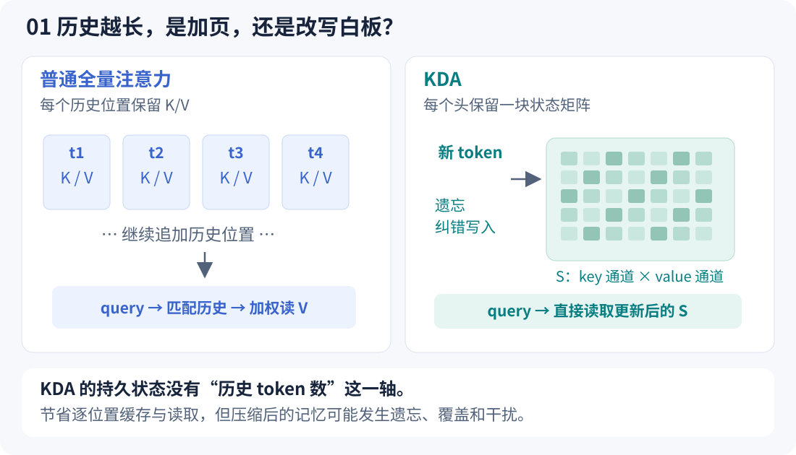
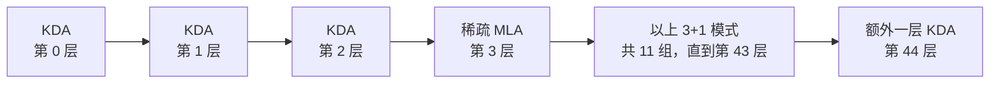
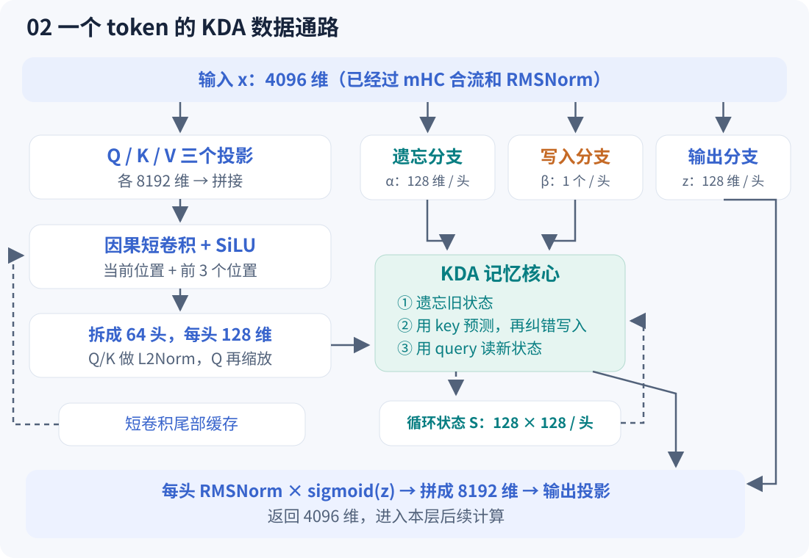
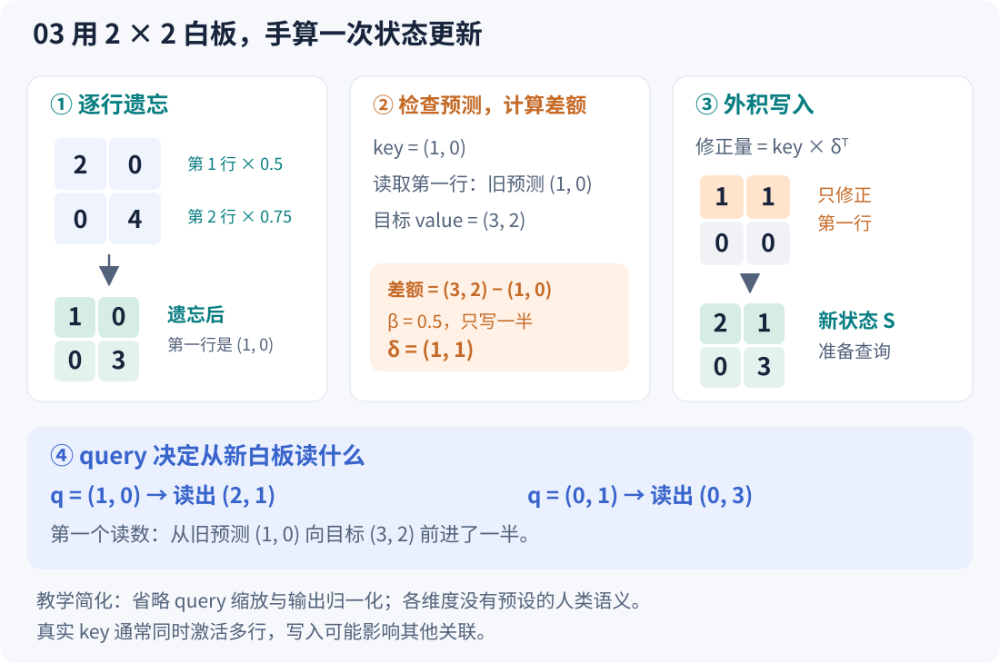
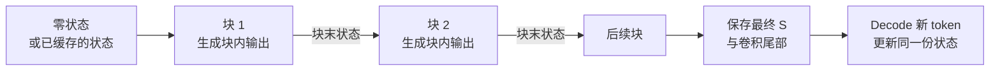

---
tags:
  - GLM
  - KDA
  - 线性注意力
  - 模型架构
---

# GLM-5.3-Flash 的 KDA 层：一块会遗忘、会纠错的记忆矩阵

!!! abstract "先用一句话理解"

    **KDA 像一块反复擦写的白板：每来一个 token，先淡化部分旧记录，再检查白板对当前信息的预测，只把预测的差额写进去，最后从更新后的白板中查询所需信息。** 白板大小固定，历史越长也不用不断加页；代价是它保存的是混合后的记忆，无法保证逐字还原所有原文。

KDA 全称 **Kimi Delta Attention**，由 Kimi Linear 工作提出。GLM-5.3-Flash 把它用作多数层的序列混合模块。这里的“记忆”是一次请求在推理中持续更新的张量，**不是修改模型权重，也不会自动成为跨对话的长期记忆**。这套机制能让远处的信息影响当前 token，同时避免每个 KDA 层都保留一份随上下文增长的逐 token K/V 列表。

本文先讲直觉，再用一个二维例子把矩阵算完，最后对照代码。若想看它怎样与 mHC、MoE 和逐 token 生成串起来，可接着读[完整推理笔记](../ai/glm-5.3-flash-inference-walkthrough.md)。

## 1. 本文依据，以及源码从哪里看

核对日期：**2026-10-21**。为便于复现，模型尺寸和行为固定到以下版本，而不依赖不断变化的 `main`：

| 来源 | 固定版本与路径 | 用来回答什么 |
|---|---|---|
| 官方模型配置 | `zai-org/GLM-5.3-Flash`，revision `eb9eb208eb0d988989d07a6a12d0fdeb5f52574a`，[`config.json`](https://huggingface.co/zai-org/GLM-5.3-Flash/blob/eb9eb208eb0d988989d07a6a12d0fdeb5f52574a/config.json) | 哪些层用 KDA、多少头、状态多大 |
| Transformers 参考实现 | commit `07338b6c74a578868368e6e549dea83414e4b8cb`，[`src/transformers/models/glm5_next/modeling_glm5_next.py`](https://github.com/huggingface/transformers/blob/07338b6c74a578868368e6e549dea83414e4b8cb/src/transformers/models/glm5_next/modeling_glm5_next.py) | 实际前向次序、遗忘门、状态递推和输出门 |
| 配置转换 | 同一 commit，[`src/transformers/models/glm5_next/configuration_glm5_next.py`](https://github.com/huggingface/transformers/blob/07338b6c74a578868368e6e549dea83414e4b8cb/src/transformers/models/glm5_next/configuration_glm5_next.py) | checkpoint 中 `linear_attn_config` 怎样映射成类属性 |
| KDA 原始论文 | [Kimi Linear，arXiv:2510.26692v1](https://arxiv.org/html/2510.26692v1)，第 2～4 节及附录 | Delta Rule、逐通道遗忘、分块计算的设计依据 |

读代码时可以按这条地图走：

| 符号 | 重点看什么 |
|---|---|
| `Glm5NextTextDecoderLayer.forward` | mHC 合流、RMSNorm 后才进入 KDA；后面还有前馈子层 |
| `Glm5NextTextLinearAttention.__init__ / forward` | 初始化投影与短卷积；运行时生成 Q/K/V 和三个门控分支 |
| `Glm5NextTextForgetGate.forward` | 对数遗忘量 `g` 怎样变成逐通道衰减 |
| `recurrent_kimi_delta_attention` | 最容易读懂的“遗忘 → 纠错写入 → 查询” |
| `chunk_kimi_delta_attention` | 多 token 输入怎样分块算出同一递推的结果 |
| `Glm5NextTextRMSNormGated.forward` | 读出的内容怎样经过归一化与输出门 |

以下描述的是这个参考实现的计算语义。vLLM、SGLang 等引擎可以融合、分片或换用其他内核；内存布局、临时空间和速度要以具体引擎为准。

## 2. 为什么要把“历史档案”换成“记忆白板”

普通因果 softmax 注意力为历史位置保留 K/V。当前 query 与可见的 key 逐一匹配，用 softmax 得到权重，再加权读取 value。它很灵活，但在全注意力 Decode 中，历史越长，需要读的历史 K/V 通常越多。

KDA 换了一种保存历史的方法：把多个位置的关联信息不断合并进一个状态矩阵 $S$，当前 query 直接读这个矩阵。**它改变了历史信息的表示与更新方式，并非把 softmax 原封不动地加速。**



*图 1：只比较一个序列混合子层。KDA 还会保留一小段短卷积状态；整个 Flash 模型另有稀疏 MLA 缓存。*

白板可以理解成一种**关联记忆**：给出一种特征方向 key，它尝试回忆对应的 value。key 是连续向量，通常同时触及多行，不能把矩阵的每一行当成某个词的独立抽屉。

例如“用户喜欢清淡口味”这样的信息，可能影响后面“推荐什么晚餐”的表示。不过，这只是帮助理解的语义类比；真实的各个通道没有人工指定的“口味栏”“姓名栏”。

### Flash 在哪些层使用它？

根据[固定版本的官方配置](https://huggingface.co/zai-org/GLM-5.3-Flash/blob/eb9eb208eb0d988989d07a6a12d0fdeb5f52574a/config.json)，文本主干共 45 层：**34 层 KDA，11 层稀疏 MLA**。按从 0 开始的层号，可写成：



这里画的是每层的**序列混合部分**。一整个 decoder 层还包括 mHC 和 Dense MLP/MoE；每个 KDA 层都有自己的状态，层与层并不共用同一块白板。

## 3. 一个 token 进入 KDA 后，分成哪些支路？

进入 KDA 的 $x_t$ 已经经过注意力前的 mHC 合流和 RMSNorm，宽度为 **4096**。由它生成的几组量各司其职：

| 量 | 通俗理解 | 单 token、单头的尺寸 |
|---|---|---|
| $q_t$ | 我现在想查什么？ | 128 维 |
| $k_t$ | 当前信息按什么特征写入？ | 128 维 |
| $v_t$ | 当前希望记住什么内容？ | 128 维 |
| $\alpha_t$ | 各个记忆通道留下多少旧内容？ | 128 个系数 |
| $\beta_t$ | 这次纠错写入多大比例？ | 1 个系数 |
| $z_t$ | 读出来后，各维内容放行多少？ | 128 维 |
| $S_{t-1}$ | 此头此前积累的记忆 | $128\times128$ |

**每个头有 128 个遗忘系数，却只有 1 个写入系数。** 此外，输出门 $z$ 控制读出的结果，不直接擦写状态；这三个门不要混在一起。上述参数化可在 [`Glm5NextTextLinearAttention` 与 `Glm5NextTextForgetGate`](https://github.com/huggingface/transformers/blob/07338b6c74a578868368e6e549dea83414e4b8cb/src/transformers/models/glm5_next/modeling_glm5_next.py) 中逐项核对。



*图 2：虚线表示跨 token 保留的缓存。Q/K/V 分支先做局部处理，门控分支直接从当前子层输入生成。*

### 短卷积：先看近处，再写进长期状态

Q、K、V 各由一个线性投影从 4096 维变成 **8192 维**，再拼起来做逐通道因果卷积和 SiLU。卷积核宽度为 **4**，因此当前的 Q/K/V 能混合**当前位置与前 3 个位置**的投影。

“逐通道”表示每个通道有自己的卷积核，不在这一步混合不同通道；“因果”表示不会用到未来 token。随后拆成 **64 个头，每头 128 维**，在 KDA 核内对 Q、K 做 L2 归一化，Q 再乘 $1/\sqrt{128}$。

这两种记忆分工不同：短卷积明确提供最近几个位置的局部信息，$S$ 则积累更长历史。**卷积宽度为 4，不代表 KDA 只能看 4 个 token。**

## 4. 核心三步：遗忘、纠错、查询

现在只看一个头。按源码布局令 $S\in\mathbb R^{d_k\times d_v}$，**行对应 key 通道，列对应 value 通道**；$q,k,v$ 全部记为列向量。下面的 $q,k$ 已包含核内归一化，$q$ 还包含缩放。

### 第一步：按通道淡化旧记忆

$$
\widetilde S_t=\operatorname{Diag}(\alpha_t)S_{t-1},\qquad
\alpha_t=\exp(g_t).
$$

对角矩阵左乘 $S$，等价于让**第 $i$ 行乘 $\alpha_{t,i}$**。有些行保留得多，有些行淡化得快。

这正是 KDA 相比 Gated DeltaNet 的关键变化：后者使用每头一个标量遗忘门，KDA 细化为**每头、每个 key 通道一个遗忘门**。[Kimi Linear 论文第 3 节](https://arxiv.org/html/2510.26692v1#S3)给出了这一设计。

在本文核对的 GLM 参考实现和配置中，安全下界路径为：

$$
\begin{aligned}
f_t&=W_{f,b}W_{f,a}x_t,\\
g_{t,h,i}&=-5\,\sigma\!\left(e^{A_{\log,h}}(f_{t,h,i}+b_{h,i})\right),\\
\alpha_{t,h,i}&=e^{g_{t,h,i}}.
\end{aligned}
$$

因此数学上 $g$ 落在 $(-5,0)$，保留比例 $\alpha$ 落在 $(e^{-5},1)$，约为 $(0.0067,1)$；数值计算可能取到边界。**配置里的 `gate_lower_bound=-5` 限制的是对数衰减量，不是让记忆乘以负五。** 这里的 $A_{\log}$、偏置和投影是训练得到的参数，$g_t$ 则随当前输入变化。

### 第二步：先问旧记忆，再写入差额

先拿当前 key 查询遗忘后的状态，得到旧预测：

$$
\widehat v_t=\widetilde S_t^\top k_t.
$$

当前希望存的是 $v_t$，旧记忆给出的是 $\widehat v_t$，因此只写入差额：

$$
\delta_t=\beta_t(v_t-\widehat v_t),\qquad
S_t=\widetilde S_t+k_t\delta_t^\top.
$$

其中 $\beta_t=\sigma(W_bx_t)$，每个头一个，范围在 0 到 1 之间。它决定这一次往目标方向改多少。

把白板想成一个已经写了答案的地方：若旧答案正确，差额就是零，不需要把同一答案再叠加一次；若旧答案有偏差，就沿着当前 key 的方向修正。**Delta 指的就是这个“目标减旧预测”的差额。**

在忽略归一化 epsilon、$\lVert k_t\rVert=1$ 的理想情形，写完再用同一个 key 查询：

$$
S_t^\top k_t
=(1-\beta_t)\widehat v_t+\beta_t v_t.
$$

这表示新预测向目标走了 $\beta_t$ 的比例。真实实现的 L2 归一化分母带有 epsilon，因此单位范数关系是近似的；但“按误差纠正”这个含义不变。若其他 key 与当前 key 不正交，这次更新也可能改变它们的读数，所以白板中的记忆会相互干扰。

### 第三步：用 query 读取更新后的状态

$$
o_t=S_t^\top q_t.
$$

**key 用来校正记忆，query 用来提取当前所需内容，两者可以不同。** 查询发生在当前 token 写入之后，所以能使用当前位置的信息，符合因果注意力可以看到自身的规则。

最后每个头对 $o_t$ 做带可学习权重的 RMSNorm，再乘 $\sigma(z_t)$；64 个头拼成 8192 维，经 `o_proj` 回到 4096 维，交还给该层的 mHC。**输出门决定本次输出多少，已保存的 $S_t$ 不由这个门直接修改。** 具体顺序见[参考实现的 `forward` 与 `Glm5NextTextRMSNormGated`](https://github.com/huggingface/transformers/blob/07338b6c74a578868368e6e549dea83414e4b8cb/src/transformers/models/glm5_next/modeling_glm5_next.py)。

## 5. 把白板缩成 2×2，真的算一次

下图和数字均为**教学例子，不是模型权重或真实语义通道**。为了只看记忆机制，把维度从 128 缩成 2，忽略 L2 归一化中的 epsilon，并暂时省略 query 的 $1/\sqrt d$ 缩放及后续输出归一化、门控和投影。



*图 3：橙色部分只修改第一行，因为此例特意选了 $k=(1,0)^\top$；真实 key 通常是稠密向量，会同时影响多行。*

初始状态和当前输入设为：

$$
S_{t-1}=\begin{bmatrix}2&0\\0&4\end{bmatrix},\quad
\alpha_t=\begin{bmatrix}0.5\\0.75\end{bmatrix},\quad
k_t=\begin{bmatrix}1\\0\end{bmatrix},\quad
v_t=\begin{bmatrix}3\\2\end{bmatrix},\quad
\beta_t=0.5.
$$

**① 遗忘。** 第一行乘 0.5，第二行乘 0.75：

$$\widetilde S_t=\begin{bmatrix}1&0\\0&3\end{bmatrix}.$$

**② 检查旧预测。** 用 $k_t=(1,0)^\top$ 读取第一行，得到 $\widehat v_t=(1,0)^\top$；而目标是 $(3,2)^\top$。差额为 $(2,2)^\top$，本次只修正一半：

$$\delta_t=0.5\left(\begin{bmatrix}3\\2\end{bmatrix}-\begin{bmatrix}1\\0\end{bmatrix}\right)=\begin{bmatrix}1\\1\end{bmatrix}.$$

**③ 写回白板。** 外积 $k_t\delta_t^\top$ 决定把修正加到哪里：

$$
S_t=\begin{bmatrix}1&0\\0&3\end{bmatrix}
+\underbrace{\begin{bmatrix}1\\0\end{bmatrix}\begin{bmatrix}1&1\end{bmatrix}}_{\text{秩一修正}}
=\begin{bmatrix}2&1\\0&3\end{bmatrix}.
$$

**④ 查询。** 若 $q_t=(1,0)^\top$，得到 $o_t=(2,1)^\top$；它正好位于旧预测 $(1,0)^\top$ 和目标 $(3,2)^\top$ 的中间。若换成 $q_t=(0,1)^\top$，读到的是 $(0,3)^\top$。

这个例子同时展示了两个独立动作：**遗忘改变哪些旧内容被保留，纠错决定新关联怎样写进去。** 第二行虽然没有被此次 key 写入，仍然在遗忘步骤中从 $(0,4)$ 变成了 $(0,3)$。

### 如果直接把新 value 加上去，会怎样？

为了单独比较写入规则，暂时取消遗忘，只看一个标量 key $k=1$、目标 value $v=3$，初始状态为 0，反复写入同一关联：

| 写入次数 | 简单累加：$S\leftarrow S+3$ | Delta Rule，$\beta=0.5$：$S\leftarrow S+0.5(3-S)$ |
|---:|---:|---:|
| 0 | 0 | 0 |
| 1 | 3 | 1.5 |
| 2 | 6 | 2.25 |
| 3 | 9 | 2.625 |
| 4 | 12 | 2.8125 |

简单累加会越堆越大，Delta Rule 则逐渐接近 3。这个简化比较解释了为什么要减掉旧预测；真实模型还包含遗忘和多个相互干扰的 key，不能据此断言所有记忆都永久稳定。

## 6. 从公式回到代码和张量

在[`recurrent_kimi_delta_attention`](https://github.com/huggingface/transformers/blob/07338b6c74a578868368e6e549dea83414e4b8cb/src/transformers/models/glm5_next/modeling_glm5_next.py)中，记忆递推可以缩写为下面的伪代码。这里省略 batch/head 维，`outer` 表示外积：

```python
# q、k 已归一化；q 还乘了 1 / sqrt(head_dim)
# S: [key_dim, value_dim]，alpha: [key_dim]
S = alpha[:, None] * S          # 每个 key 通道独立遗忘
old_value = S.T @ k             # 遗忘后，用当前 key 检查旧预测
delta = beta * (v - old_value)  # 计算本次纠错量
S = S + outer(k, delta)         # 更新记忆
output = S.T @ q                # 从更新后的记忆读取
```

实际代码用乘法与求和实现相应收缩，例如 `(S * k[..., None]).sum(dim=-2)` 就是在 key 轴求和。**这里先左乘遗忘门，再做 delta 修正；把这两个步骤交换，通常会改变结果。**

对应 Flash 的完整尺寸如下，$B$ 是请求数，$T$ 是这次调用输入的 token 数：

| 张量 | 形状 | 存放什么 |
|---|---|---|
| 子层输入 | `[B,T,4096]` | 已合流、已归一化的隐藏表示 |
| Q、K、V | 各 `[B,T,64,128]` | 查询、写入方向、目标内容 |
| 对数遗忘量 `g` | `[B,T,64,128]` | 每个头、每个 key 通道的衰减控制 |
| 写入强度 `beta` | `[B,T,64]` | 每个头的纠错比例 |
| 循环状态 `S` | `[B,64,128,128]` | 每个头的关联记忆，没有历史长度轴 |
| 核输出 | `[B,T,64,128]` | 各位置从更新后的状态读到的内容 |
| 最终子层输出 | `[B,T,4096]` | 门控归一化、拼头、输出投影后的结果 |

一个头的状态不是“128 个历史 token × 128 维内容”。这里两个 128 都是**特征维**，所以即使历史从一千增长到十万 token，持久循环状态的形状也不变。

## 7. 第一次输入与后续生成，怎样延续同一块白板？

### 初始化：参数与请求状态是两回事

构造 `Glm5NextTextLinearAttention` 时会建立 Q/K/V 投影、分组短卷积、遗忘门、写入门和输出门等模块；加载 checkpoint 后，这些模块持有训练好的参数。

**新请求的循环记忆则从零开始。** 核函数收到 `initial_state=None` 时构造全零 $S$。序列开头没有足够的卷积历史，因果卷积用零填充补齐。随后每处理一个位置，就让这次请求的状态继续向前更新。

### Prefill：长段输入用分块方式计算

Prompt 的所有 token 已知，可以先并行生成投影和门控，再把 KDA 递推改写成分块计算。参考实现的 `chunk_kimi_delta_attention` 默认 `chunk_size=64`：**块内组织成带因果约束的矩阵运算，块间传递状态**，最后得到各位置的输出和末尾状态。



这不是让块内每个位置偷看后面的内容：分块公式保留因果约束，是对逐 token 递推的代数重排。浮点运算顺序和内核可能造成小的数值差异；分块大小也属于实现选择，**不是模型只能记 64 个 token**。分块推导见[KDA 论文第 3.1 节及附录](https://arxiv.org/html/2510.26692v1#S3.SS1)。

### Decode：一个新 token 接着更新

参考实现的分支条件为：**本层已有历史状态，并且 `seq_len == 1`**，才使用单步递推路径：

1. 从本层缓存读出 `conv_states[0]` 和 `recurrent_states[0]`。
2. 用 `causal_conv1d_update` 加入新投影，更新短卷积尾部。
3. 用 `recurrent_kimi_delta_attention` 更新并读取 $S$。
4. 将新的循环状态以 FP32 写回本层缓存，供下一次调用继续使用。

其他情形走分块路径，包括第一次 Prefill、带历史状态的多 token 续接，以及尚无历史状态的单 token 输入。**Prefill 和 Decode 延续的是同一套记忆语义，区别在于如何组织计算。** 分支与缓存更新见[参考实现的 `Glm5NextTextLinearAttention.forward`](https://github.com/huggingface/transformers/blob/07338b6c74a578868368e6e549dea83414e4b8cb/src/transformers/models/glm5_next/modeling_glm5_next.py)。

## 8. 它省在哪里，又付出了什么？

固定头数和头维后，KDA 单个新 token 对循环状态的更新与读取约为 $O(Hd_kd_v)$，**不会因为历史变长而逐个扫描更多旧 token**；处理 $T$ 个 token 的序列混合工作量随 $T$ 线性增长。线性指这里与序列长度的关系，并不表示内部全是线性函数，或所有场景都一定更快。

| 对比项 | 普通全量因果 softmax 注意力 | KDA |
|---|---|---|
| 历史表示 | 逐位置 K/V | 固定尺寸状态矩阵与短卷积尾部 |
| 单步历史混合成本 | 随可见历史长度增加 | 固定头维下基本不随历史长度增加 |
| 信息读取 | query 对可见 key 打分后加权读 V | query 直接从更新后的 $S$ 读取 |
| 主要能力代价 | 保留长历史需要更多缓存和读取 | 有限状态中可能发生覆盖、遗忘和干扰 |

表中的成本只比较序列混合核心；投影、前馈、并行通信和硬件带宽也会影响整模型性能。GQA、MLA、稀疏注意力等还会改变左列的具体常数与读取范围。

### “固定尺寸”到底多大？

按上述配置与参考实现的 FP32 状态类型，单个请求、单个 KDA 层的循环状态为：

$$64\times128\times128\times4\ \text{bytes}=4\ \text{MiB}.$$

34 个 KDA 层合计 **136 MiB**。这是未分片的逻辑循环状态量，**不含短卷积状态、临时张量、模型权重，也不含 11 层稀疏 MLA 的缓存**；更不是整模型的显存占用。实际引擎的状态类型、分片和分配方式也可能不同。[配置](https://huggingface.co/zai-org/GLM-5.3-Flash/blob/eb9eb208eb0d988989d07a6a12d0fdeb5f52574a/config.json)与[状态写回实现](https://github.com/huggingface/transformers/blob/07338b6c74a578868368e6e549dea83414e4b8cb/src/transformers/models/glm5_next/modeling_glm5_next.py)分别给出了这个计算的尺寸和类型依据。

### 为什么还要穿插稀疏 MLA？

KDA 的固定白板混合了历史，无法保证每条细节都被完整保留。Flash 的稀疏 MLA 路径另行保留可按历史位置寻址的 latent KV，再由索引器挑选位置供主注意力读取，因此两类层提供了互补的信息访问方式。它能回看的是**被选中的位置**，不能据此保证任意细节都能找回。

从机制上理解，KDA 负责持续维护紧凑记忆，稀疏 MLA 提供按位置检索的路径。这是对两种结构分工的解释，不是声称我们已经观察到某个头或某层具有固定的人类语义职责。

## 9. 用这五个问题检查自己是否理解

| 问题 | 应该怎样回答 |
|---|---|
| 历史存在哪里？ | 每个 KDA 层、每个头各自的状态矩阵，另有局部卷积尾部 |
| KDA 与 Gated DeltaNet 的关键差别？ | 遗忘从每头一个标量细化为每个 key 通道一个系数 |
| Delta Rule 写的是什么？ | 当前目标 value 减去遗忘后旧预测的差额，再乘写入强度 |
| 当前 query 读哪个状态？ | 已包含当前 token 写入的 $S_t$ |
| 整个 Flash 的缓存都不随长度增长吗？ | 只有这里的 KDA 持久状态固定；稀疏 MLA 仍保留历史缓存 |

若自己复现时对不上参考实现，优先检查：**状态轴是否为 `[key_dim,value_dim]`、是否先遗忘再求旧预测、Q/K 的 L2 归一化与 Q 缩放是否一致、分块续接是否同时传递了循环状态和卷积尾部**。这些地方都会直接改变数值结果。

!!! note "验证范围"

    本文核对了固定版本的配置、参考源码与原论文，并用教学数字验证矩阵更新。未在本地运行 GLM-5.3-Flash 权重，也未测量 GPU/NPU 吞吐；文中的尺寸推算不能当作硬件实测结果。

## 参考与延伸阅读

- [GLM-5.3-Flash 官方配置，固定 revision](https://huggingface.co/zai-org/GLM-5.3-Flash/blob/eb9eb208eb0d988989d07a6a12d0fdeb5f52574a/config.json)
- [Transformers 模型参考实现，固定 commit](https://github.com/huggingface/transformers/blob/07338b6c74a578868368e6e549dea83414e4b8cb/src/transformers/models/glm5_next/modeling_glm5_next.py)
- [Transformers 配置解析，固定 commit](https://github.com/huggingface/transformers/blob/07338b6c74a578868368e6e549dea83414e4b8cb/src/transformers/models/glm5_next/configuration_glm5_next.py)
- [Kimi Linear 原始论文 v1](https://arxiv.org/html/2510.26692v1)
- [MoonshotAI / Kimi-Linear 官方仓库](https://github.com/MoonshotAI/Kimi-Linear)
- [本站：GLM-5.3-Flash 推理运算全过程](../ai/glm-5.3-flash-inference-walkthrough.md)
